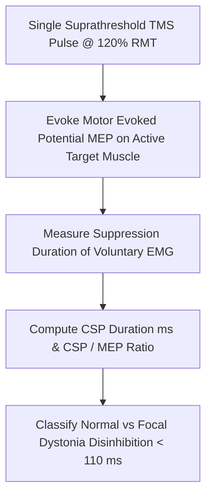

# Cortical Silent Period (CSP) TMS Personal Agent Skill

[](LICENSE)
[](https://www.python.org/)
[]()
[]()
[]()

Deterministic, zero-mock personal agent micro-skill for calculating Transcranial Magnetic Stimulation (TMS) Cortical Silent Period Duration (ms) and MEP-Normalized Ratio to quantify motor cortex $\text{GABA}_B$ intracortical inhibition.

## Architecture



## Quickstart

```python
from client import CorticalSilentPeriodTMSClient

client = CorticalSilentPeriodTMSClient()
result = client.evaluate_csp(
    csp_duration_ms=165.0,
    mep_amplitude_mv=3.8,
    stimulus_intensity_pct_rmt=120.0
)
print(result)
```

## License

Apache-2.0
